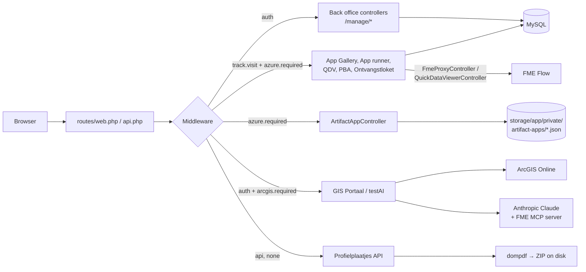

# QuickManage — Developer Handover Guide

> **Start here** if you are taking over QuickManage. This guide is the single entry point: it explains
> what the application does, how it is put together, how to run it, where everything lives, and what
> the known risks and loose ends are. It links to the more detailed per-topic docs in this folder.
>
> **State of the code described:** `master` as of November 2026 (last commit: *"QuickDataViewer | Fixed
> security issues"*). Where this guide and an older doc disagree, **this guide reflects the current code**
> — see [§16 Outdated statements in older docs](#16-outdated-statements-in-older-docs).

---

## Table of contents

1. [What is QuickManage?](#1-what-is-quickmanage)
2. [Tech stack](#2-tech-stack)
3. [Getting it running locally](#3-getting-it-running-locally)
4. [Repository layout](#4-repository-layout)
5. [Architecture & request flow](#5-architecture--request-flow)
6. [Authentication — three separate mechanisms](#6-authentication--three-separate-mechanisms)
7. [Route map (by access level)](#7-route-map-by-access-level)
8. [Modules](#8-modules)
9. [Data & storage](#9-data--storage)
10. [Configuration (environment variables)](#10-configuration-environment-variables)
11. [External integrations](#11-external-integrations)
12. [Frontend & asset build](#12-frontend--asset-build)
13. [Conventions & recipes](#13-conventions--recipes)
14. [Deployment notes](#14-deployment-notes)
15. [Known issues & technical debt](#15-known-issues--technical-debt)
16. [Outdated statements in older docs](#16-outdated-statements-in-older-docs)
17. [Handover checklist](#17-handover-checklist)

---

## 1. What is QuickManage?

QuickManage is an internal **GKB Groep** web application (Laravel 12) that acts as a **portal and
management tool for GIS / FME-based tools**. In short:

- **Admins** (QuickManage login) manage *apps* in a back office (`/manage/*`):
  - **FME apps** — a form page that is generated automatically from the published parameters of an
    FME Flow workspace. End users fill in the form, the request is proxied to FME Flow and the result
    is returned (download, HTML, JSON).
  - **Custom apps** — tiles that simply link to an external (or internal) URL.
  - Apps are organised in **folders** (admin-side grouping) and **categories** (public App Gallery grouping),
    and are rendered with a visual **template** (logo, header, footer, background colour).
- **End users** (GKB employees signing in with **Microsoft SSO**) use the **App Gallery**
  (`/app-gallery/overzicht`) to find and run those apps.
- Several **stand-alone tools** are hosted in the same codebase:
  - **QuickDataViewer** — browser GIS viewer for Shapefile / GeoPackage / File-GDB / DWG files.
  - **Ontvangstloket IW** and **PBA FMUTA6 indexatie** — business tools that call FME Flow.
  - **Artifact apps** (`/eisenhower`, `/leeghwater`) — apps originally built as Claude artifacts,
    now self-hosted with a local JSON "database".
  - **GIS Portaal** — ArcGIS Online map browser with an AI **GIS Assistent** (Claude + FME MCP).
  - **AI NL→WHERE** (`/testAI`) — experimental natural-language → SQL WHERE clause for an ArcGIS layer (Ollama).
  - **Profielplaatjes API** — stateless JSON → PDF/ZIP generator called by FME.
- **Analytics** — live "who is using which app right now" via a browser heartbeat.

The UI language is **Dutch**; code comments are a mix of Dutch and English.

---

## 2. Tech stack

| Layer | Technology |
|---|---|
| Backend | PHP **8.2+** (dev machine runs 8.4), **Laravel 12**, Laravel 11+/12-style bootstrap ([bootstrap/app.php](../bootstrap/app.php) — no `Kernel.php`, no `Handler.php`) |
| Auth | `laravel/ui` (username/password), `laravel/socialite` + `socialiteproviders/microsoft-azure` (Entra ID SSO), custom ArcGIS OAuth2 |
| PDF | `barryvdh/laravel-dompdf` (Profielplaatjes) |
| Database | **MySQL** (dev + server). Sessions, cache and queue all use the `database` driver |
| Frontend | Blade, Bootstrap 5.2, jQuery, Font Awesome (CDN), plain JS / ES modules under [public/js/](../public/js/) |
| Maps | OpenLayers + proj4 (EPSG:28992, QuickDataViewer); ArcGIS Maps SDK for JS (GIS Portaal) |
| Asset build | **Laravel Mix** (webpack) — [webpack.mix.js](../webpack.mix.js). `vite.config.js` is **not used** |
| External | FME Flow (`fme.gkbgroep.nl`), ArcGIS Online, Microsoft Entra ID, Anthropic Claude API, Ollama (local), PDOK geocoder |

---

## 3. Getting it running locally

### Prerequisites

- PHP 8.2+ with `pdo_mysql`, `mbstring`, `openssl`, `curl`, `zip`, `fileinfo`, `gd` (dompdf images)
- Composer 2, Node.js 18+ and npm
- MySQL / MariaDB
- Optional, per module: access to FME Flow, an ArcGIS Online OAuth app, an Entra ID app registration,
  an Anthropic API key, a local Ollama with `gemma3:12b`

### Steps

```powershell
composer install
npm install
copy .env.example .env
php artisan key:generate
# Fill in DB_* and the integration keys (see §10)
php artisan storage:link      # REQUIRED: logos and uploaded thumbnails are served from /storage
npm run dev                   # compile SCSS/JS (or: npm run watch)
php artisan serve             # http://127.0.0.1:8000
```

> ⚠️ **The database cannot be built from migrations alone.** The committed migrations only create the
> stock Laravel tables (`users`, `sessions`, `cache`, `jobs`, …) and add indexes to `user_analytics`.
> The feature tables (`apps`, `custom_apps`, `app_categories`, `app_galleries`, `folders`, `templates`,
> `user_analytics`) and extra `users` columns (`uniqid`, `image`) **have no create-migration**.
> Get a schema dump (or full copy) of the existing database from the server, import it, and only then
> run `php artisan migrate`. Committing proper migrations is the #1 tech-debt item — see §15.
>
> Note also that [2026_06_10_000000_add_indexes_to_user_analytics_table.php](../database/migrations/2026_06_10_000000_add_indexes_to_user_analytics_table.php)
> uses MySQL-only `ALTER TABLE … MODIFY` syntax, so SQLite is not an option.

### Logging in

- **Back office**: `/` shows the login form. Registration is **disabled**
  (`Auth::routes(['register' => false])`), so create users via `php artisan tinker` or directly in the DB.
  Remember to set `uniqid` (UUID) — the menu and profile pages depend on it:

  ```php
  App\Models\User::create(['name' => 'Dev', 'email' => 'dev@example.com',
      'password' => 'secret123', 'uniqid' => (string) Str::uuid()]);
  ```
- **End-user pages** (`azure.required`): either be logged in to the back office (that also passes), or
  configure the `AZURE_*` variables to use Microsoft SSO.

### Useful commands

| Command | Purpose |
|---|---|
| `php artisan route:list --except-vendor` | Full route table (≈93 routes) |
| `php artisan test` | Runs PHPUnit (only the Laravel example tests exist) |
| `php artisan pail` | Tail logs live |
| `npm run watch` | Rebuild assets + BrowserSync proxy on `127.0.0.1:8000` |
| `npm run prod` | Minified production build |
| `GET /ping` → `pong`, `GET /up` | Health checks (used by FME HTTPCaller / monitoring) |

---

## 4. Repository layout

```
app/
  Http/Controllers/          One controller per feature (see §8)
    Api/                     Stateless API (Profielplaatjes)
    Auth/                    laravel/ui controllers + AzureAuthController + LogoutAGOLController
  Http/Middleware/           RequireAzureLogin, RequireArcgisLogin, TrackPageVisit, SetVisitorIdCookie (+ stock)
  Models/                    Eloquent models (App, CustomApp, AppCategorie, AppGallery, Folder, Template, User, userAnalytics)
  Services/                  ProfielPlaatjeService, ArtifactApps/{ArtifactPageBuilder, JsonDocumentStore}
  Support/ZipWriter.php      Dependency-free ZIP writer (Profielplaatjes)
  Mail/PasswordResetMail.php
bootstrap/app.php            Routing, middleware aliases, global exception handling
config/
  services.php               All integration settings (ArcGIS, Azure, FME, Claude, FME MCP)
  artifact_apps.php          Registry of hosted Claude artifact apps
database/migrations/         Stock tables + user_analytics indexes ONLY (see §3)
docs/                        This documentation
public/
  js/<feature>/              Hand-written, non-bundled JS per feature (loaded directly by Blade)
  css/                       Compiled CSS (output of Mix — do not edit by hand)
  storage -> storage/app/public   (symlink/junction created by `php artisan storage:link`)
resources/
  views/                     Blade views per feature (pages/*, quickdataviewer, gisportaal, …)
  sass/                      SCSS sources (+ custom_apps/ for stand-alone tools)
  apps/<slug>/               Source of the Claude artifact apps (eisenhower, leeghwater)
routes/
  web.php                    Almost all routes
  api.php                    Profielplaatjes API (prefix /api, no session/CSRF)
storage/app/
  public/                    Logos, thumbnails, profile images (served via /storage)
  private/artifact-apps/     JSON "databases" of the artifact apps
  profielplaatjes/           Generated ZIP files
```

---

## 5. Architecture & request flow



Key points:

- **Classic MVC, thin controllers.** No repository layer; services exist only for Profielplaatjes and
  artifact apps. Validation is done inline with `$request->validate()`.
- **Middleware** (registered in [bootstrap/app.php](../bootstrap/app.php)):

  | Alias / registration | Class | Purpose |
  |---|---|---|
  | appended to `web` group | [SetVisitorIdCookie](../app/Http/Middleware/SetVisitorIdCookie.php) | Sets a 1-year `visitor_id` UUID cookie for analytics |
  | `track.visit` | [TrackPageVisit](../app/Http/Middleware/TrackPageVisit.php) | Upserts a `user_analytics` row (heartbeat) |
  | `azure.required` | [RequireAzureLogin](../app/Http/Middleware/RequireAzureLogin.php) | Passes if logged in to QuickManage **or** SSO session with allowed e-mail domain |
  | `arcgis.required` | [RequireArcgisLogin](../app/Http/Middleware/RequireArcgisLogin.php) | Requires a non-expired ArcGIS token in the session |

- **Global exception handling** (in `bootstrap/app.php`): DB connection errors (`2002`, `Connection refused`,
  `SQLSTATE[HY000]`) render [errors/db-connection.blade.php](../resources/views/errors/db-connection.blade.php) with HTTP 503.
  Custom error pages for 401/403/404/419/429/500/503 live in [resources/views/errors/](../resources/views/errors/).
- **Secrets stay server-side** for the newer features: FME tokens are used only in
  [FmeProxyController](../app/Http/Controllers/FmeProxyController.php) and
  [QuickDataViewerController](../app/Http/Controllers/QuickDataViewerController.php); the Claude key
  only in [GISAssistentController](../app/Http/Controllers/GISAssistentController.php).
  (Some older JS still contains FME tokens — see §15.)

More detail: [architecture.md](architecture.md).

---

## 6. Authentication — three separate mechanisms

QuickManage has **three independent login mechanisms**. Understanding which one protects which page is essential.

| # | Mechanism | Who | Stored where | Guard | Logout |
|---|---|---|---|---|---|
| 1 | **QuickManage login** (`laravel/ui`, e-mail + password) | Admins / developers | Laravel `auth` session, `users` table | `auth` | `POST /logout` |
| 2 | **Microsoft Entra ID SSO** (Socialite `azure` driver) | All GKB employees with an `@gkbgroep.nl` address (`AZURE_ALLOWED_DOMAIN`) | Session key `azure.user` = `{id, name, email}` — **no DB user is created** | `azure.required` | `POST /auth/azure/logout` |
| 3 | **ArcGIS Online OAuth2** (authorization code) | Users of GIS Portaal / testAI | Session keys `arcgis.access_token`, `arcgis.expires_in`, `arcgis.expires_at`, `arcgis.username` | `arcgis.required` (in combination with `auth`) | `POST /logoutAGOL` |

### SSO flow (mechanism 2)

1. Visitor opens a page behind `azure.required` → [RequireAzureLogin](../app/Http/Middleware/RequireAzureLogin.php).
2. If `Auth::check()` (QuickManage user) → allowed immediately.
3. Else, if no `azure.user` in session → redirect to `/auth/azure/redirect?redirect=<original URL>`
   (JSON/XHR requests get a **401 JSON** instead, so front-end code can show "herlaad de pagina").
4. [AzureAuthController::callback](../app/Http/Controllers/Auth/AzureAuthController.php) checks the e-mail domain,
   stores `azure.user` and redirects back to the original URL (default `/app-gallery/overzicht`).
5. A wrong domain gets [errors/azure-forbidden.blade.php](../resources/views/errors/azure-forbidden.blade.php) (403).

The Socialite Azure driver is registered in [AppServiceProvider](../app/Providers/AppServiceProvider.php) via the `SocialiteWasCalled` event.
When `APP_DEBUG=true` a failed callback **`dd()`s** state/session diagnostics (useful for "invalid state" problems
behind an HTTPS proxy — check `TrustProxies` / `SESSION_DOMAIN` / `APP_URL`).

### ArcGIS flow (mechanism 3)

`GET /arcgis/loginAGOL` (closure in [routes/web.php](../routes/web.php)) → ArcGIS `/sharing/oauth2/authorize` →
`GET /oauth-callback` → [GISPortaalController::callback](../app/Http/Controllers/GISPortaalController.php) exchanges the code,
stores the token in the session and redirects to `/gisportaal`. The `ARCGIS_REDIRECT_URI` must be registered
exactly in the ArcGIS app. There is no refresh-token handling; on expiry the user is sent to log in again.

Details: [modules/auth.md](modules/auth.md), [integrations.md](integrations.md).

---

## 7. Route map (by access level)

Run `php artisan route:list --except-vendor` for the authoritative list. Summary:

### Public (no auth)

| Method | Path | Handler |
|---|---|---|
| GET | `/` | Login view |
| GET | `/ping`, `/up` | Health checks |
| GET | `/docs` | [DOCSController](../app/Http/Controllers/DOCSController.php) → end-user documentation page ([documentation/index.blade.php](../resources/views/documentation/index.blade.php)) |
| * | `/login`, `/logout`, `/password/*`, `/email/*` | `Auth::routes(['verify' => true, 'register' => false])` |
| GET | `/auth/azure/redirect`, `/auth/azure/callback`; POST `/auth/azure/logout` | [AzureAuthController](../app/Http/Controllers/Auth/AzureAuthController.php) |
| GET | `/arcgis/loginAGOL`, `/oauth-callback` | ArcGIS OAuth (closure + [GISPortaalController::callback](../app/Http/Controllers/GISPortaalController.php)) |
| POST | `/api/profielplaatjes/generate` | [ProfielplaatjeApiController](../app/Http/Controllers/Api/ProfielplaatjeApiController.php) ⚠️ unauthenticated |
| GET | `/api/profielplaatjes/download/{file}` | idem |

### `auth` — back office

| Path prefix | Controller |
|---|---|
| `/dashboard`, `/dashboard/live-visitors` | [DashboardController](../app/Http/Controllers/DashboardController.php) |
| `/manage/apps/*` (create/store/edit/update/delete), `/manage/apps/{unique}/fme/services` | [AppsController](../app/Http/Controllers/AppsController.php), [FmeProxyController](../app/Http/Controllers/FmeProxyController.php) |
| `/manage/custom-apps/*` | [CustomAppsController](../app/Http/Controllers/CustomAppsController.php) |
| `/manage/app-gallery`, `/manage/app-gallery/category/*` | [AppGalleryController](../app/Http/Controllers/AppGalleryController.php) (+ `update-apps` / `update-custom-apps` in the app controllers) |
| `/manage/folders`, `/manage/folder/create`, `/manage/folders/*` | [FoldersController](../app/Http/Controllers/FoldersController.php) |
| `/manage/templates`, `/manage/template/*` | [TemplatesController](../app/Http/Controllers/TemplatesController.php) |
| `/manage/profile/{unique}/edit` | [ProfileController](../app/Http/Controllers/ProfileController.php) |
| `/manage/analytics`, `/manage/analytics/live-visitors`, `/manage/analytics/live-apps` | [AnalyticsController](../app/Http/Controllers/AnalyticsController.php) |
| `/manage/accounts`, `/manage/settings` | [AccountController](../app/Http/Controllers/AccountController.php), [SettingsController](../app/Http/Controllers/SettingsController.php) — **placeholder pages** (views only) |

### `track.visit` + `azure.required` — end-user pages

| Path | Handler |
|---|---|
| `/app-gallery/overzicht`, `/app-gallery/{cat_uniqid}` | [AppGalleryController](../app/Http/Controllers/AppGalleryController.php) (public gallery) |
| `/apps/view/{hash_id}` | [AppsController::show](../app/Http/Controllers/AppsController.php) — renders the FME app form |
| `/apps/{hash_id}/fme/parameters` · `upload` · `run` | [FmeProxyController](../app/Http/Controllers/FmeProxyController.php) |
| `/manage/quickdataviewer`, `POST /api/quickdataviewer/convert-gdb` · `convert-dwg` | [QuickDataViewerController](../app/Http/Controllers/QuickDataViewerController.php) |
| `/PBA-FMUTA6-VerwerkWeekIndexatie` | [PBA_IWController](../app/Http/Controllers/PBA_IWController.php) |
| `/Ontvangstloket-IW` | [Ontvangstloket_IWController](../app/Http/Controllers/Ontvangstloket_IWController.php) |
| `/visit-heartbeat` | Analytics heartbeat (204, the middleware does the work) |

> The QuickDataViewer path starts with `/manage/` and its API with `/api/`, but both are **web** routes
> behind `azure.required`, not back-office or `routes/api.php` routes.

### `azure.required` — artifact apps

For every slug in [config/artifact_apps.php](../config/artifact_apps.php) (`eisenhower`, `leeghwater`):
`GET /<slug>`, `GET /<slug>/api/snapshot`, `GET /<slug>/api/query`, `POST /<slug>/api/write`,
`POST /<slug>/api/profiles`, `POST /<slug>/api/assets`, `GET /<slug>/_blob/{asset}`.

### `auth` + `arcgis.required`

`/gisportaal`, `/gisportaal/groups/{groupId}/maps`, `POST /gisportaal/assistant` (`throttle:10,1`),
`/testAI`, `POST /logoutAGOL`.

### `auth` + `throttle:10,1`

`POST /ai/nl2where`, `GET /ai/nl2where-stream`.

---

## 8. Modules

Each module: what it does → main files → gotchas. Detailed docs are linked where they exist.

### 8.1 Back office: folders, FME apps, custom apps
*Docs: [modules/folders.md](modules/folders.md), [modules/apps.md](modules/apps.md), [modules/custom-apps.md](modules/custom-apps.md)*

- **Workflow**: `/manage/folders` → open a folder → create FME apps / custom apps inside it.
- **Folder context is session-based**: [FoldersController::show](../app/Http/Controllers/FoldersController.php)
  stores `folder_id`, `folder_name`, `folder_url` in the session. `AppsController::store` and
  `CustomAppsController::store` use `session('folder_id')`. Creating an app without opening a folder first
  results in `folder_id = null`.
- **Creating an FME app** ([pages/apps/create.blade.php](../resources/views/pages/apps/create.blade.php) +
  [public/js/HTMLPage/CreateHTMLPage_Form.js](../public/js/HTMLPage/CreateHTMLPage_Form.js)): the admin picks
  repository → workspace → service from FME Flow, a template, a category, and enters the **per-app FME
  workspace token** (`wsp_token`), which is stored **encrypted** (`Crypt::encryptString`, depends on `APP_KEY`).
- **Editing**: the services dropdown is fetched through `GET /manage/apps/{unique}/fme/services` (server-side proxy).
- **Thumbnails** are stored on the `public` disk (`storage/app/public/app_thumbnails/`, `custom_app_thumbnails/`)
  and the **file name** is saved in the DB.
- Custom-app creation happens in a modal on the folder page via AJAX
  ([public/js/custom_app/create.js](../public/js/custom_app/create.js)); the standalone create route is commented out.

### 8.2 FME app runner + FME proxy

- `GET /apps/view/{hash_id}` renders [html_templates/GKB_Realisatie_Style.blade.php](../resources/views/html_templates/GKB_Realisatie_Style.blade.php)
  with the app's template, and [public/js/HTMLPage/displayHTMLpage.js](../public/js/HTMLPage/displayHTMLpage.js)
  builds the form dynamically from FME's published parameters.
- **All FME calls go through [FmeProxyController](../app/Http/Controllers/FmeProxyController.php)**:
  - `parameters` → FME v4 `workspaces/{repo}/{wsp}/parameters`
  - `upload` → uploads to `FME_SHAREDRESOURCE_TEMP` (max 500 MB/file)
  - `run` → branches on the app's `service`:
    `fmejobsubmitter` (`/fmeapiv4/jobs/sync`), `fmedatadownload` (returns FME JSON with a temporary result URL),
    `fmedatastreaming` (response streamed back in 8 KB chunks).
- Repository/workspace/service are **read from the DB**, never from the request — the client cannot aim the
  token at another workspace. The decrypted token is never sent to the browser (`App::$hidden = ['wsp_token']`).
- FME host: `FME_BASE_URL` (default `https://fme.gkbgroep.nl`).

### 8.3 App Gallery & categories
*Docs: [modules/app-gallery.md](modules/app-gallery.md)*

- Public: `/app-gallery/overzicht` (all categories) → `/app-gallery/{cat_uniqid}` (FME + custom apps in that category).
  This is the **landing page for SSO users**.
- Admin: `/manage/app-gallery` — create / inline-edit / delete categories and assign apps via checkboxes
  ([public/js/app_gallery/category.js](../public/js/app_gallery/category.js), JSON endpoints `update-apps` / `update-custom-apps`).
- Deleting a category sets `cat_id = null` on its apps (apps are not deleted).
- `app_galleries` is a single-row parent table; only `AppGallery::first()` is used.

### 8.4 Templates
*Docs: [modules/templates.md](modules/templates.md)*

Name, background colour, dummy image, header logo, footer image (stored in `storage/app/public/template_images/`).
Routes use the numeric `id`. There is **no delete** action.

### 8.5 Profile, accounts, settings, dashboard

- [ProfileController](../app/Http/Controllers/ProfileController.php): edit own name/e-mail/avatar; inline ownership check on `users.uniqid` (403 otherwise).
- Accounts and Settings are **empty placeholder pages**.
- Dashboard shows a live-visitor counter (`/dashboard/live-visitors`, last 10 s).

### 8.6 Analytics (live usage)

- [public/js/visitor-heartbeat.js](../public/js/visitor-heartbeat.js) is included on end-user layouts/pages
  (gallery, app runner, QDV, PBA, Ontvangstloket). Every 5 s while the user is active (no activity for 25 s
  or hidden tab → stops) it calls `GET /visit-heartbeat?page_url=…`.
- [TrackPageVisit](../app/Http/Middleware/TrackPageVisit.php) upserts one row per `visitor_id` cookie in
  `user_analytics` (`page_url`, `last_seen_at`, `active`, `visitorName` from QuickManage user or SSO session).
  Failures are logged and never break the page.
- [userAnalytics::markInactive()](../app/Models/userAnalytics.php) flips rows to inactive after
  `INACTIVE_AFTER_SECONDS = 10`; throttled with a cache lock.
- `/manage/analytics` shows totals plus live polling of `live-visitors` and `live-apps` (maps `apps/view/{hash_id}` back to app names).
- **To track a new end-user page**: add the `track.visit` middleware *and* include `visitor-heartbeat.js` in the view.

### 8.7 QuickDataViewer
*Docs: [modules/quickdataviewer.md](modules/quickdataviewer.md)*

Client-side OpenLayers viewer in RD New (EPSG:28992). Shapefile ZIP(s) and GeoPackage are parsed **in the browser**;
File-GDB (zipped) and DWG are uploaded to Laravel which uploads them to FME Flow (`FME_SERVER_URL`, `FME_DWG_SERVER_URL`,
`FME_SERVER_TOKEN`) and returns a `converted.gpkg`. Client code: [public/js/quickdataviewer/](../public/js/quickdataviewer/)
(entry `index.js`; `_app_quickdataviewer.js` is the unused legacy monolith). FME errors are logged with the token
redacted and only a generic message reaches the browser. The view hard-codes links to `http://gisdev.gkbgroep.nl/app-gallery/overzicht`.

### 8.8 Ontvangstloket IW & PBA FMUTA6 indexatie

Stand-alone business tools (own layouts and CSS in `resources/sass/custom_apps/`):

- **Ontvangstloket IW** (`/Ontvangstloket-IW`): creates supplier-specific "ontvangsten" CSVs for import into IW.
  The form is driven by [public/js/ontvangstloket_iw/app_settings.json](../public/js/ontvangstloket_iw/app_settings.json)
  (fields, groups, FME submit target `Administratie/Ontvangstloket.fmw`, `fmedatastreaming`);
  [main.js](../public/js/ontvangstloket_iw/main.js) calls FME Flow **directly from the browser**.
- **PBA FMUTA6** (`/PBA-FMUTA6-VerwerkWeekIndexatie`): manage/process weekly indexation rates;
  [public/js/PBA_FMUTA6/main.js](../public/js/PBA_FMUTA6/main.js) calls an FME Flow API on `fme-gkb.fmecloud.com` **directly from the browser**.

Both still embed an FME token in client JS — see §15.

### 8.9 Artifact apps (Eisenhower, Leeghwater)
*Docs: [modules/artifact-apps.md](modules/artifact-apps.md) — read this before touching them.*

Apps originally built as Claude artifacts, served at `/<slug>`. Source in [resources/apps/](../resources/apps/),
assembled per request by [ArtifactPageBuilder](../app/Services/ArtifactApps/ArtifactPageBuilder.php) (no build step).
`window.claude` is shimmed by [public/js/artifact-apps/claude-runtime.js](../public/js/artifact-apps/claude-runtime.js)
against [ArtifactAppController](../app/Http/Controllers/ArtifactAppController.php). **Data is NOT in MySQL**: it lives in
`storage/app/private/artifact-apps/<slug>/database.json` (+ `assets/`) via [JsonDocumentStore](../app/Services/ArtifactApps/JsonDocumentStore.php)
(file lock + atomic replace, last-write-wins). **Back up these files** — they contain live project data.
Add a new app by adding an entry to [config/artifact_apps.php](../config/artifact_apps.php); routes are generated automatically.

### 8.10 GIS Portaal + GIS Assistent

- `/gisportaal` ([GISPortaalController](../app/Http/Controllers/GISPortaalController.php)): after ArcGIS login it lists the
  user's ArcGIS groups (`/sharing/rest/community/self`) and, per group, its Web Maps (`/sharing/rest/search`), shown with the
  ArcGIS Maps SDK ([public/js/gisportaal/](../public/js/gisportaal/)).
- **GIS Assistent** (`POST /gisportaal/assistant`, 10 req/min): [GISAssistentController](../app/Http/Controllers/GISAssistentController.php)
  calls the Anthropic Messages API (`ANTHROPIC_MODEL`, default `claude-sonnet-4-6`) with the **MCP connector**
  (`anthropic-beta: mcp-client-2025-04-04`) pointing to the FME MCP server (`FME_MCP_URL`, "OpenDataInfo").
  The Dutch system prompt forces Claude to answer **only via MCP tools** and in a fixed Markdown format.
- `index()` still contains commented-out leftovers from the AI module (`$res` is undefined → `$data` is always empty).

### 8.11 AI NL→WHERE (`/testAI`) — experimental
*Docs: [modules/ai.md](modules/ai.md)*

[AIController](../app/Http/Controllers/AIController.php) converts a Dutch question into a SQL `WHERE` clause for the
hard-coded ArcGIS layer `GKB_DL_Bomen` using a **local Ollama** (`http://127.0.0.1:11434`, `gemma3:12b`). The WHERE is
sanitised against an allow-list of layer fields. Endpoint hard-coded, so it only works where Ollama runs.
`AIController::callback` is **no longer routed** (the OAuth callback now goes to GIS Portaal).

### 8.12 Profielplaatjes API

`POST /api/profielplaatjes/generate` (called by FME) accepts up to 250 profiles (see
[docs/examples/profielplaatjes-request.json](examples/profielplaatjes-request.json)), renders one A4-landscape PDF per profile
with an inline SVG chart ([ProfielPlaatjeService](../app/Services/ProfielPlaatjeService.php) +
[profielplaatje/pdf.blade.php](../resources/views/profielplaatje/pdf.blade.php)), zips them with
[ZipWriter](../app/Support/ZipWriter.php) into `storage/app/profielplaatjes/` and returns a `download_url`.
No authentication and no clean-up of old ZIPs (see §15). [ProfielplaatjeController](../app/Http/Controllers/ProfielplaatjeController.php)
(sample data) is not routed and its view does not exist — dead code.

---

## 9. Data & storage

### Database tables (MySQL)

| Table | Model | Public ID used in URLs | Notes |
|---|---|---|---|
| `users` | [User](../app/Models/User.php) | `uniqid` (UUID) | + `image` (file name). Custom password-reset mail |
| `apps` | [App](../app/Models/App.php) | `hash_id` (UUID) | `name, description, template_id, repository, workspace, service, folder_id, cat_id, wsp_token (encrypted), app_thumbnail` |
| `custom_apps` | [CustomApp](../app/Models/CustomApp.php) | `uniqid` (UUID) | `custom_app_url, folder_id, cat_id, custom_app_thumbnail` |
| `app_categories` | [AppCategorie](../app/Models/AppCategorie.php) | `uniqid` (12 random chars) | `category_name, description, app_gallery_id` |
| `app_galleries` | [AppGallery](../app/Models/AppGallery.php) | — | single row |
| `folders` | [Folder](../app/Models/Folder.php) | `uniqid` (UUID) | `folder_name` |
| `templates` | [Template](../app/Models/Template.php) | `id` | `name (unique), background_color, dummy_image, header_logo, footer_image` |
| `user_analytics` | [userAnalytics](../app/Models/userAnalytics.php) | — | `visitor_id (unique), visitorName, page_url, last_seen_at (indexed), active` |
| `sessions`, `cache`, `jobs`, … | — | — | Laravel stock (database drivers) |

Relations: `App → template(), folder(), app_category()`; `CustomApp → custom_app_category()`;
`AppCategorie → app_categorie_app_galleries()` (its `app_categorie_pages()` relation is broken — see §15).
See [data-model.md](data-model.md).

### Files on disk

| Location | Content | Back up? |
|---|---|---|
| `storage/app/public/` (served at `/storage`) | Logos (`logo-cm.png`, `conversie_logo.png`, …), `app_thumbnails/`, `custom_app_thumbnails/`, `template_images/`, `profile_images/`, `GIS_Assistent/` | **Yes** (uploads) |
| `storage/app/private/artifact-apps/<slug>/` | `database.json` + `assets/` of artifact apps | **Yes — live business data** |
| `storage/app/profielplaatjes/` | Generated ZIPs | No (temporary) |
| `storage/logs/` | Laravel logs | — |

### Session keys & cookies

| Key | Set by | Used by |
|---|---|---|
| `azure.user`, `azure.intended` | AzureAuthController | RequireAzureLogin, TrackPageVisit, ArtifactAppController |
| `arcgis.*` | GISPortaalController::callback | RequireArcgisLogin, GIS Portaal, AIController |
| `folder_id`, `folder_name`, `folder_url` | FoldersController::show | App/CustomApp store, views |
| `app_id` | AppsController::show | — |
| cookie `visitor_id` | SetVisitorIdCookie | TrackPageVisit |

---

## 10. Configuration (environment variables)

Besides the standard Laravel keys (`APP_*`, `DB_*`, `SESSION_*`, `CACHE_STORE`, `QUEUE_CONNECTION`, `MAIL_*`):

| Variable | Config key | Used by |
|---|---|---|
| `APP_KEY` | `app.key` | **Also decrypts `apps.wsp_token`** — never rotate without re-encrypting tokens |
| `AZURE_CLIENT_ID`, `AZURE_CLIENT_SECRET`, `AZURE_TENANT_ID`, `AZURE_REDIRECT_URI` | `services.azure.*` | SSO |
| `AZURE_ALLOWED_DOMAIN` | `services.azure.allowed_domain` (default `gkbgroep.nl`) | SSO domain check |
| `ARCGIS_PORTAL`, `ARCGIS_CLIENT_ID`, `ARCGIS_CLIENT_SECRET`, `ARCGIS_REDIRECT_URI` | `services.arcgis.*` | GIS Portaal, testAI |
| `FME_BASE_URL` | `services.fme.base_url` (default `https://fme.gkbgroep.nl`) | FmeProxyController |
| `FME_SERVER_URL`, `FME_DWG_SERVER_URL`, `FME_SERVER_TOKEN` | `services.fme.*` | QuickDataViewer conversions |
| `ANTHROPIC_API_KEY`, `ANTHROPIC_MODEL` | `services.claude.*` | GIS Assistent |
| `FME_MCP_URL` | `services.fme_mcp.url` | GIS Assistent |
| `ARTIFACT_APPS_STORAGE` | `artifact_apps.storage_path` | Artifact apps data folder |
| `MAIL_*` | `mail.*` | Password reset mail |

`.env` (local) and `.env-server` (server copy) are **git-ignored** and contain real secrets — obtain them through a
secure channel, never from chat/e-mail, and never commit them. [.env.example](../.env.example) is missing the
ArcGIS / FME / Anthropic / artifact keys listed above; use this table as the reference.

---

## 11. External integrations

| System | Purpose | Auth | Code |
|---|---|---|---|
| **FME Flow** (`fme.gkbgroep.nl`, v4 REST + datastreaming/datadownload) | Run app workspaces, file conversions | `fmetoken` per app (encrypted in DB) or `FME_SERVER_TOKEN` | FmeProxyController, QuickDataViewerController, (client JS for PBA / Ontvangstloket / app create) |
| **FME Cloud** (`fme-gkb.fmecloud.com`) | PBA indexatie API | token in client JS | public/js/PBA_FMUTA6/main.js |
| **Microsoft Entra ID** | SSO for end users | OAuth2/OIDC (Socialite) | AzureAuthController |
| **ArcGIS Online** (`gkb.maps.arcgis.com`) | Groups, web maps, feature layers | OAuth2 user token | GISPortaalController, AIController |
| **Anthropic Claude** + **FME MCP server** | GIS Assistent | API key | GISAssistentController |
| **Ollama** (local) | NL→WHERE | none | AIController |
| **PDOK Locatieserver** | Address search in QDV | none | public/js/quickdataviewer/search/addressSearch.js |
| **SMTP** | Password reset | `MAIL_*` | PasswordResetMail |

Outgoing HTTP calls to ArcGIS / Anthropic use `verify => app()->isProduction()`, i.e. **TLS verification is off unless
`APP_ENV=production`**. Make sure production really runs with `APP_ENV=production`.

See [integrations.md](integrations.md) for sequence diagrams.

---

## 12. Frontend & asset build

- **Laravel Mix** compiles `resources/js/app.js` → `public/js/app.js` and each SCSS in [webpack.mix.js](../webpack.mix.js)
  → `public/css/*.css`. Feature SCSS for stand-alone tools lives in `resources/sass/custom_apps/`.
- **Feature JavaScript is not bundled**: it lives as plain files/ES modules in `public/js/<feature>/` and is included directly
  by Blade (`<script src="{{ asset('js/…') }}">`). Edit those files directly; no build needed.
- **Compiled CSS is committed** (`public/css`). After changing SCSS run `npm run dev` (or `prod`) and commit the output.
- Layouts: [layouts/app.blade.php](../resources/views/layouts/app.blade.php) (back office, includes
  [includes/menu.blade.php](../resources/views/includes/menu.blade.php)), `GKB_AppGallery_layout`, `GKB_Realisatie_Page`
  (app runner), `gisportaal`, `aiTest`. QuickDataViewer, PBA and Ontvangstloket views are full standalone HTML pages.
- Back-office menu items are hard-coded in `includes/menu.blade.php` (with an inline script that highlights the active item).
- `vite.config.js`, `tailwindcss` and `@tailwindcss/vite` are leftovers from the Laravel skeleton and are not used.
  Composer's `setup` script calls `npm run build`, which does not exist — use the manual steps in §3 instead.

More: [frontend.md](frontend.md).

---

## 13. Conventions & recipes

*See also [conventions.md](conventions.md).*

- **Public identifiers**: routes bind `{unique}` to a UUID column (`hash_id` for apps, `uniqid` for the rest), never the PK
  (exception: templates). Generate with `Str::uuid()` in a `do … while (exists())` loop.
- **Uploads**: `$file->storeAs('<folder>', $filename, 'public')`; save only the file name; render with `asset('storage/<folder>/'.$name)`.
- **Messages**: redirect with `back()->with('success', '…')` (Dutch text); AJAX endpoints return JSON.
- **Secrets**: never put tokens/keys in `public/js` or Blade. Add them to `config/services.php` + `.env` and call the
  external service from a controller (follow [FmeProxyController](../app/Http/Controllers/FmeProxyController.php)).
- **Middleware aliases** are added in [bootstrap/app.php](../bootstrap/app.php).

### Recipe: add a new stand-alone end-user tool

1. Controller in `app/Http/Controllers/`, view in `resources/views/<tool>/index.blade.php`.
2. Route inside the `['track.visit', 'azure.required']` group in [routes/web.php](../routes/web.php).
3. JS in `public/js/<tool>/`, SCSS in `resources/sass/custom_apps/<tool>.scss` + register in `webpack.mix.js`.
4. Include `<script src="/js/visitor-heartbeat.js"></script>` for analytics.
5. Any external call with credentials → server-side proxy endpoint.
6. Make it reachable for SSO users by adding it as a **Custom App** (URL = the route) in a gallery category.

### Recipe: add a new FME app (no code)

Back office → Apps → open a folder → *Nieuwe app* → choose repository / workspace / service, template, category,
enter the workspace token → save. It appears at `/apps/view/{hash_id}` and in its gallery category.

---

## 14. Deployment notes

There is no CI/CD or deploy script in the repo. Deploying is manual; a typical sequence:

```powershell
git pull
composer install --no-dev --optimize-autoloader
php artisan migrate --force
npm ci; npm run prod            # or commit built assets and skip this
php artisan storage:link        # first deploy only
php artisan config:cache; php artisan route:cache; php artisan view:cache
```

Checklist:

- `APP_ENV=production`, `APP_DEBUG=false` (otherwise TLS verification is off and the Azure callback may `dd()` debug data).
- Same `APP_KEY` as before (it decrypts the FME workspace tokens).
- Writable: `storage/` and `bootstrap/cache/`. Persist/back up `storage/app/public` and `storage/app/private/artifact-apps`.
- Behind a reverse proxy/HTTPS: configure trusted proxies and a correct `APP_URL`, otherwise Socialite `InvalidStateException`
  and wrong redirect URIs occur.
- Redirect URIs registered in Entra ID and ArcGIS must exactly match `AZURE_REDIRECT_URI` / `ARCGIS_REDIRECT_URI`.
- PHP limits: QDV and FME uploads allow 500 MB → set `upload_max_filesize`, `post_max_size`, and web-server body limits accordingly;
  conversions can take up to 5–10 minutes (`set_time_limit(600)`), so check FastCGI/proxy timeouts.
- `queue:work` is not needed (no queued jobs are dispatched), and there is no scheduler.
- After changing `.env` with cached config: `php artisan config:clear` (or re-cache).

---

## 15. Known issues & technical debt

Ordered by priority. See also [known-issues.md](known-issues.md).

### 🔴 Security

1. **Hard-coded FME tokens in browser JavaScript** — anyone who opens these pages can read them:
   - [public/js/HTMLPage/CreateHTMLPage_Form.js](../public/js/HTMLPage/CreateHTMLPage_Form.js) (back office app creation)
   - [public/js/PBA_FMUTA6/main.js](../public/js/PBA_FMUTA6/main.js)
   - [public/js/ontvangstloket_iw/main.js](../public/js/ontvangstloket_iw/main.js) (`FME_TOKEN`)

   **Fix**: move these calls to server-side proxy endpoints (pattern: `FmeProxyController`), then **revoke and rotate** the
   exposed tokens in FME Flow. They are also in git history.
2. **Profielplaatjes API is unauthenticated** — anyone can trigger CPU-heavy PDF generation and download generated ZIPs
   (names are guessable-ish: timestamp + 6 random chars). Add an API token/shared secret or IP allow-list and a rate limit.
3. **No authorisation within the back office** — every QuickManage user can edit/delete everything (no Gates/Policies, no roles).
4. **TLS verification disabled outside production** (`verify => app()->isProduction()`), and `dd()` of OAuth state in the
   Azure callback when `APP_DEBUG=true`.

### 🟠 Reliability / maintainability

5. **Missing migrations** for all feature tables and `user_analytics` (see §3). Generate from the production schema
   (e.g. `php artisan schema:dump` on a copy) and commit.
6. **No automated tests** beyond Laravel's examples.
7. **Generated ZIPs are never cleaned up** (`storage/app/profielplaatjes/`). Add a scheduled clean-up.
8. **Artifact-app data lives only in JSON files** — include them in backups; concurrent edits are last-write-wins.
9. `.env.example` lacks most integration keys (see §10).
10. Hard-coded hosts: `https://fme.gkbgroep.nl/...` upload URL in QuickDataViewerController (ignores `FME_BASE_URL`),
    `http://gisdev.gkbgroep.nl` links in the QDV view, ArcGIS layer URLs and Ollama endpoint in AIController.

### 🟡 Dead / leftover code

- [ProfielplaatjeController](../app/Http/Controllers/ProfielplaatjeController.php) (not routed, view missing),
  [HomeController](../app/Http/Controllers/HomeController.php) (not routed),
  `AIController::callback` (not routed), commented-out ArcGIS query in `GISPortaalController::index` (`$res` undefined).
- [app/Models/_WorkspaceParameter.php](../app/Models/_WorkspaceParameter.php) and the `AppCategorie → Page` relation reference a non-existent `Page` model.
- `use Hashids\Hashids;` in AppsController (package not installed — unused import).
- [public/js/quickdataviewer/_app_quickdataviewer.js](../public/js/quickdataviewer/_app_quickdataviewer.js), empty
  `public/js/profielplaatje/main.js`, root-level test files (`test.json`, `test2.json`, `testGeoApps.json`, `*.html` samples).
- `vite.config.js`, Tailwind deps — not used with Mix; composer `setup` script calls the non-existent `npm run build`.
- `DashboardController::liveVisitors` and `AnalyticsController::liveVisitors` compute the count differently.
- `FoldersController::delete($id)` receives the numeric id although the route parameter is named `{unique}` (works, but confusing).
- `VerificationController::$redirectTo = '/home'` — `/home` is not a route.

---

## 16. Outdated statements in older docs

The other files in `docs/` were written earlier. The following points in them **no longer match the code**:

| Older doc says | Current reality |
|---|---|
| Images are stored as base64 in DB columns ([architecture.md](architecture.md), [conventions.md](conventions.md)) | Files are stored on the `public` disk; the DB stores the file name |
| QuickDataViewer routes are public ([known-issues.md](known-issues.md), [modules/quickdataviewer.md](modules/quickdataviewer.md)) | Behind `track.visit` + `azure.required` |
| `routes/api.php` is unused | Used for the Profielplaatjes API |
| `/apps/view/{unique}` and the gallery are public | Behind `azure.required` (SSO or QuickManage login) |
| OAuth callback → `AIController@callback`, redirects to `/testAI` | `GISPortaalController@callback`, redirects to `/gisportaal` |
| `displayHTMLpage.js` contains an FME token; path `public/js/displayHTMLpage.js` | Uses the server-side FME proxy; file is in `public/js/HTMLPage/`. Tokens remain in `CreateHTMLPage_Form.js`, PBA and Ontvangstloket JS |
| Registration is available | `register => false` |
| QDV uses `withoutVerifying()` | No longer; errors are logged with the token redacted |
| Only `arcgis.required` middleware alias | Also `azure.required`, `track.visit`, and `SetVisitorIdCookie` on the web group |

---

## 17. Handover checklist

Make sure the new developer receives (through a secure channel) or is granted:

- [ ] Access to the GitHub repository `JobGorsel2/QuickManage`
- [ ] `.env` for local development and the server `.env` (incl. the **production `APP_KEY`**)
- [ ] A database dump / schema of the production DB (needed because migrations are incomplete)
- [ ] Server access (SSH/RDP), web-server config, PHP config, and the deploy procedure for `gisdev.gkbgroep.nl` / production
- [ ] FME Flow admin access (`fme.gkbgroep.nl`, `fme-gkb.fmecloud.com`) — repositories `Administratie`, `Projecten`, …, and the tokens in use
- [ ] Microsoft Entra ID app registration (client id/secret, redirect URIs) — owner rights in Azure
- [ ] ArcGIS Online OAuth app (`gkb.maps.arcgis.com`) — client id/secret, redirect URI
- [ ] Anthropic account / API key and FME MCP server details
- [ ] A QuickManage back-office account
- [ ] Location of backups for `storage/app/public` and `storage/app/private/artifact-apps`
- [ ] Walk-through of §15 (security items 1–2 should be addressed first)
